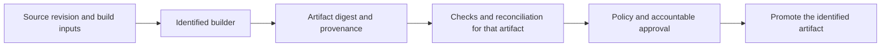

# Artifact Provenance Gates

An artifact provenance gate makes a promotion decision using trustworthy evidence about the particular artifact being promoted. It connects [[concepts/software-supply-chain-security]] to [[concepts/modernization-traceability]]: a tested source revision is insufficient if deployment substitutes a different binary or configuration.

Google's *Building Secure and Reliable Systems*, Chapter 14, describes binary provenance, trustworthy builders, deployment policy enforcement and later verification. This page applies those mechanisms to modernization; the local record and approval rules below are proposed design choices.

## Bind evidence to identity

Chapter 14 recommends authenticated provenance identifying output artifacts, typically by content hash, and useful inputs such as source revisions, dependencies, build commands and environments. A signature establishes who asserted the provenance and protects integrity; confidence in the assertion also depends on the builder and the threat model.

The diagram is a modernization synthesis, not the book's exact pipeline. Connect check results to fixture/environment versions as well as artifact identity. Record the recipe/configuration and relevant rule dispositions when interpreting the evidence.

| Evidence | Question answered |
|---|---|
| Source and build-input identifiers | What inputs produced this candidate? |
| Builder identity and authenticated provenance | Why trust the asserted origin? |
| Artifact digest and check-run record | Which candidate was actually checked? |
| Policy revision, decision and approver | What allowed this promotion? |
| Deployment/exception record | What actually ran, including bypasses? |

Passing checks on one digest should not authorize another digest merely because both carry the same release name. Re-evaluate approvals when relevant artifacts, inputs, accepted exceptions or policy change; do not let an old human response authorize a substituted candidate.

## Constrain the execution boundary

Chapter 5 recommends narrow functional APIs, least privilege, multi-party authorization and granular audit records. For a modernization platform, assign distinct capabilities for proposing changes, executing transformations, validating evidence and promoting a release. Apply enforcement at the action boundary, alongside explicit responsibilities.

A second model agreeing with a proposal does not itself create an independent business oracle or a trustworthy authorization boundary. The gate needs the policy, evidence and authority defined outside the candidate's own self-assessment.

## Retain and recheck

Chapter 14 also explains why deployment-time checks need later verification: policies change, enforcement may fail open, and an operator may use emergency access. Record such exceptions and evaluate already deployed artifacts under applicable policy changes.

Chapter 15 recommends structured, timestamped investigation records and logs that resist alteration, with an audit trail for alterations. It also discusses privacy constraints, so immutable logging is not a rule to preserve all sensitive payloads forever. Keep enough identity and decision evidence to investigate a transition under an explicit retention/access policy.

## Limits

Trusted provenance can faithfully describe a build of defective code. Reproducibility, trustworthy provenance, functional acceptance and authorization answer different questions. Use [[concepts/modernization-evaluation-corpus]] and the agreed acceptance contract alongside origin verification.

## Worked example: approval for one artifact

A **digest** is a content-derived identifier such as a cryptographic hash. It helps compare artifact identity; knowing a digest alone does not tell you who produced the artifact. A **signature** authenticates an assertion under an accepted key and protects its integrity. Trust also depends on the signer/builder, key protection and what the assertion actually says.

The following identifiers are symbolic examples, not real hashes or deployment records:

| Event | Evidence | Gate result |
|---|---|---|
| Candidate `A1` is built | Digest `H1`, authenticated builder/input record | Origin can be checked under the defined policy |
| Run `R1` checks `A1` | `H1`, fixture/environment versions, acceptance and recovery results | Results apply to that tested identity and context |
| Owner approves the pilot | `H1`, rule/evidence revisions, policy `P1`, allowed action | Approval is scoped to these conditions |
| A rebuild produces `A2` | Different digest `H2`, same release label | Reject reuse of the `H1` approval; establish applicable evidence for `H2` |
| The worker tries to approve its own release | Worker has execution permission only | Reject the unauthorized action |

*Continuous Delivery*, Chapter 5, explains promoting the binaries already built and tested. For this case, a proposed pipeline builds once, runs unit checks, verifies business outputs/effects, tests required architectural and recovery properties, then evaluates promotion policy for that artifact. Google Chapter 13 explains why unit and integration tests contribute different evidence: a fake receiver's call record does not establish that the actual receiver accepted the intended effect.

Test the gate by substituting `H2`, removing a required check, using an unaccepted signer and presenting an expired or incompatible decision. Each must stop promotion under this example policy. Then verify that the complete `H1` evidence permits only the approved pilot action. These are suggested gate tests, not a claim that this repository implements a deployment system.

Record both the decision and what actually deployed. If policy or a vulnerability assessment changes later, recheck deployed artifacts and handle exceptions through accountable review. A genuine signature on defective code does not make that code correct.

**Check your understanding:** An artifact's hash matches an approved label in a spreadsheet. Does this establish trustworthy origin and functional acceptance? No. Identity, authenticated provenance, applicable check evidence and authorization are separate obligations.

## Related

- [[concepts/modernization-traceability]] — requirements and decision lineage
- [[concepts/modernization-workflow-recovery]] — durable approval and exception states
- [[concepts/software-supply-chain-security]] — toolchain and dependency trust
