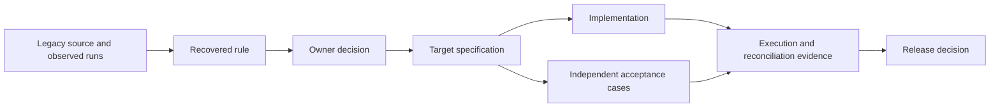

# Modernization Traceability

**Modernization traceability** is the inspectable chain connecting legacy evidence, a business decision, a target requirement, implementation, tests, and release evidence. It makes retention and intentional change explicit. It complements [[concepts/legacy-behavioral-parity]] within [[concepts/enterprise-legacy-modernization]].

## Concrete published mechanisms

The AWS/OpenAI [Codex forward-engineering example](https://aws.amazon.com/blogs/migration-and-modernization/forward-engineering-aws-transform-generated-business-requirements-with-openai-codex/) carries REQ identifiers into specifications, uses `@LegacyRules` on implementation methods and `@CoversLegacyRules` on tests, and checks missing or inconsistent coverage in a build gate. Its authors explicitly distinguish structural completeness from faithful implementation, which still requires review.

AWS's preceding [mainframe specification article](https://aws.amazon.com/blogs/migration-and-modernization/from-mainframes-to-microservices-specification-driven-mainframe-modernization-with-ai-agents/) separates recovered legacy requirements, domain specifications, and target acceptance requirements. That article uses Kiro; its results must not be silently attributed to Codex.

## An evidence chain for a business flow

This is a proposed generalized model. Recovery and redesign produce different facts: "the code currently does this" does not establish "the business wants this in the target."

## Proposed minimum ledger

| Field | Purpose |
|---|---|
| Stable rule ID and business-flow ID | Preserve identity through splitting and implementation changes |
| Legacy revision, file/member, and source range | Make the source reference reproducible |
| Observation and provenance | Distinguish source inference, observed runtime behavior, and SME confirmation |
| Rule and acceptance conditions | State the obligation in testable business language |
| Disposition and decision owner | Explain retention, change, retirement, or unresolved status |
| Target specification and implementation references | Locate where the obligation should be delivered |
| Acceptance cases and run identifiers | Locate independent evidence that it is delivered |
| Approved exception and release/checkpoint | Explain a deliberate difference and when it takes effect |

Use a revision or immutable source snapshot alongside line ranges; file line numbers move during edits. When one requirement maps to several services, keep the parent identifier and explicit derived IDs rather than creating unrelated copies.

## Rule dispositions

The following vocabulary is a proposed local design, not a quoted vendor enumeration.

- **Retain:** preserve the agreed behavior and supply parity evidence.
- **Change:** record the owner-approved replacement rule and its acceptance cases.
- **Retire:** record why the behavior is obsolete and verify that its consumers no longer require it.
- **Unresolved:** expose missing business intent or conflicting evidence; identify who decides it.

An unresolved critical rule blocks acceptance of the affected flow. It need not stop discovery or implementation of independent work. A change to a known legacy defect must remain visible rather than being hidden inside a refactor.

## Two separate gates

**Structural gate:** every in-scope rule has a disposition; retained/changed rules link to target specifications, implementation, and acceptance evidence; referenced IDs exist; retirement decisions have an owner. This can be checked deterministically, including in CI.

**Semantic gate:** the recovered rule is accurate, the disposition reflects current business intent, and the target satisfies it. Domain review, [[concepts/legacy-behavioral-parity|differential execution]], and relevant operational tests provide this evidence.

A ledger can be perfectly connected and wrong everywhere. Generating both code and tests from the same misunderstood requirement does not introduce an independent oracle. [[concepts/code-review]] and [[concepts/security-and-governance/agent-separation-of-duties]] address the review boundary.

## Relationship to plans and context

[[concepts/spec-driven-development]] controls what the agent should deliver. An execution plan controls the work sequence, progress, decisions, and validation. The traceability ledger controls what business obligation each artifact represents; these documents serve different purposes.

OpenAI's [modernization cookbook](https://developers.openai.com/cookbook/examples/codex/code_modernization) uses reviewable pilot documents and an execution plan. For enterprise use, connect those documents to the ledger instead of retaining intent only in prompts.

The [[raw/articles/2025-08-29_humanlayer-advanced-context-engineering-coding-agents|HumanLayer brownfield report]] shows why review of discovery and plans matters: mistaken dependency assumptions can propagate into a plausible implementation. Preserve uncertainty and evidence locations when compacting context. See [[concepts/harness-engineering/context-engineering]].

## Failure modes

- **Citation laundering:** an agent-generated source reference is accepted without checking the actual code or run.
- **Coverage inflation:** many annotations or tests reference an ID without checking its important outcomes.
- **Lost exceptions:** legacy quirks disappear during summarization or conversion into a cleaner target domain model.
- **Premature closure:** "implemented" becomes "accepted" without execution evidence or a decision owner.
- **Unowned redesign:** architecture generation silently changes data ownership, timing, or transaction guarantees.

## Related

- [[concepts/enterprise-legacy-modernization]] — delivery sequence and architecture choices
- [[concepts/legacy-behavioral-parity]] — semantic verification and cutover
- [[concepts/spec-driven-development]] — target contracts
- [[queries/codex-enterprise-modernization-cases]] — supporting examples and attribution
