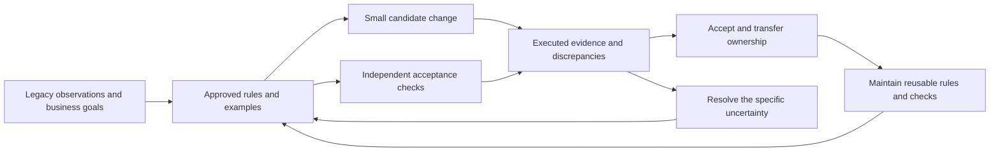

# AI Modernization Strategy for the V Model Shoulders

**Recommendation:** manage modernization as a sequence of accepted business changes, with reusable evidence connecting requirements to tests. Invest the capacity released by faster implementation in discovering consequential unknowns, making acceptance repeatable and reducing repeated expert decisions. Expand agent production only as fast as the team can establish intent, verify effects and safely transfer operational ownership.

For engineering leaders and modernization teams, the useful interpretation of the V-model problem is a **shift in the delivery constraint**: generating a candidate becomes easier than establishing that it is the right replacement. The response combines the existing [[queries/modernization-inner-loop-reading|inner loop]] of project delivery with the [[queries/modernization-outer-loop-reading|outer loop]] of improving and reusing the delivery method. The companion [[queries/modernization-v-model-pilot|pilot playbook]] supplies responsibilities, decision records, measures and rollout gates.

## Diagnose which burden has increased

The V model relates requirement and design levels to corresponding verification and validation levels. Its diagram is not a labor allocation chart, and those correspondences can be maintained in short iterations. A larger share of effort at its shoulders does not establish an absolute increase. If requirements/design and testing each remain 30 hours while implementation falls from 40 to 10, total labor falls from 100 to 70 hours although each shoulder's share rises from 30% to about 43%. If each shoulder instead rises to 45 hours, the total returns to 100. These are illustrative calculations, not measured effects.

Separate the following mechanisms before choosing a remedy. Record active labor separately from elapsed waiting and compare like-for-like scope and acceptance standards.

| Mechanism | Observable signal | Appropriate response |
|---|---|---|
| Previously hidden obligations become visible | Undocumented cutoff rules, exception handling or data ownership disputes appear | Decide retain/change/retire; fund necessary discovery and identify its owner |
| Work moves earlier or quality improves | More early tests, fewer late defects; the final obligation is unchanged | Evaluate whole-flow effort and outcomes before calling the investment waste |
| New setup costs precede reuse | Legacy execution, fixtures and comparison adapters are built once | Separate setup from recurring cost; test whether a second comparable flow benefits |
| Faster generation increases work in progress | Larger diffs, more concurrent candidates, older review/decision queues | Limit admission and change size to acceptance capacity |
| AI introduces avoidable work | Unsupported rules, brittle tests, misleading summaries, changed expectations | Strengthen evidence requirements; use deterministic transformations; stop ineffective automation |
| Cheap implementation expands scope | An upgrade becomes a redesign; more features and tests enter the denominator | Price optional work separately and preserve the original modernization objective |

The hypothesis is plausible but **not a universal empirical law**. The archived DORA *Impact of Generative AI*, v2025.2, reports associations with faster code review and approval alongside worse delivery throughput/stability; it treats larger batches as a possible explanation, not an established causal mechanism. This distinguishes local speed from system outcomes and challenges a blanket claim that review always gets slower. Its survey associations are not estimates of modernization shoulder labor. ^[raw/papers/2025_google_dora-gen-ai/impact-of-generative-ai.md]

The separate [2025 DORA report overview](https://dora.dev/research/2025/dora-report/) describes AI as amplifying existing organizational strengths and weaknesses. [METR's July 2025 trial](https://metr.org/blog/2025-07-10-early-2025-ai-experienced-os-dev-study/) found tasks took 19% longer for 16 experienced open-source developers on 246 issues using early-2025 tools. Its [February 2026 update](https://metr.org/blog/2026-02-24-uplift-update/) says later results are unreliable for estimating the current effect because of selection and time-measurement problems. Neither establishes a current Codex modernization effect or the V-model burden distribution. Together they justify measuring actual accepted work rather than importing a speedup claim.

## Preserve the V model correspondence within small business flows

Use one bounded business flow as the planning, implementation and acceptance unit. Examples include producing a statement, applying an approved fee or importing one partner feed. A file, service or generated PR may be too small to expose the business obligation; an entire application may be too large to verify economically.

| Left side decision | Right side evidence planned with it |
|---|---|
| Business objective and behavior to retain/change/retire | Owner-reviewed examples, reconciliation and retirement evidence |
| System boundary, data ownership and operating requirements | End-to-end effects, representative load, recovery and cutover rehearsal |
| Component contracts and design constraints | Contract, integration, property and architectural fitness checks |
| Implementation choice | Build, static checks and focused unit tests |

This proposed loop preserves requirements-to-test traceability while allowing discovery, design and verification to inform one another. Do enough discovery to authorize the next bounded change and its acceptance procedure; reserve broader analysis for dependencies, irreversible decisions and high-impact uncertainty. A large document completed before any executable feedback can reproduce the original bottleneck.

## Seven strategies and why they reduce repeated work

### 1 Choose the smallest change that achieves the business objective

Agree a measurable objective before selecting a target architecture: eliminate an unsupported runtime, shorten an operational cutoff, remove a dependency or enable a specific business change. Consider retirement, improvement in place, upgrade, replatforming and selective replacement. A modular monolith may satisfy the goal without introducing distributed transactions or additional contracts.

Use seams, adapters and staged replacement to confine the affected obligations. Separate behavior-preserving migration from approved business-rule changes, with explicit exceptions when the target requires a change. This reduces the combinations the design and testing teams must reason about. It does not make a narrow patch low risk when it touches shared state or a critical dependency. See [[concepts/incremental-legacy-migration]] and [[concepts/legacy-code-seams]].

### 2 Turn discovery into decisions that can be reused

Have the agent assemble a source-linked dossier from code, schedulers, schemas, reference data, production observations and runbooks. Distinguish source inference, observed behavior and owner-approved intent. Ask the SME to resolve a concrete disagreement with examples and consequences, rather than review an unbounded generated requirements document. Expertise and authority to change a rule may belong to different people.

Maintain a rule ledger with disposition, rationale, applicability, owner, examples and review trigger. Group repeated questions by the underlying rule. A resolved question should update the reusable record and its check; otherwise every agent session pays the same interview cost. Retrieve only the applicable rules for a task, retaining unresolved or conflicting evidence. A knowledge base without ownership and invalidation can propagate an old mistake faster. See [[concepts/modernization-traceability]] and [[concepts/living-documentation]].

### 3 Make approved examples the bridge between the shoulders

Before implementation, a domain owner, developer and verifier agree representative examples, boundaries, prohibited effects and intentional differences. Publish human-readable views and execute checks from those versioned examples. Keep technical adapters separate from business meaning so an API change does not require rewriting the business rule. This reduces translation and reconciliation among specifications, test plans and implementation tickets.

For the [[queries/modernization-batch-example|fictional fee batch]], an approved input of 1999 cents produces a fee of 49, associated with the correct account and one durable notification intent. A candidate returning 50 fails even if its generated tests expect 50. The old observation supplies evidence; the owner's decision supplies authority. Unresolved critical intent blocks acceptance of that flow, while isolated discovery experiments can continue. [[concepts/specification-by-example]] and [[concepts/specification-based-test-design]] explain the distinction between agreeing meaning and selecting cases.

### 4 Build acceptance capability before increasing generation volume

Automate cheap, repeatable checks first, then deeper checks according to the change's risks. Preserve distinct evidence for business correctness, data/effects, architecture, resilience and release integrity. Output parity can accept a wrapper that still uses the runtime slated for retirement; therefore also check the retirement objective under an environment without that runtime. Normalize only explicitly incidental differences, preserving material mismatches.

Challenge the checker: seed a wrong-account result, a duplicate effect, a missing material field and a known architectural violation. For selected critical logic, mutation testing reveals weak assertions; exploratory testing and independent business examples address omissions that mutants cannot. A second agent may help find defects but does not supply independence if it shares the same erroneous specification. The expected outcome must have an independent, reviewed basis, and the implementer must not silently weaken it. Google's testing chapter supports requirements-based checks, testability seams and combining test levels. ^[raw/papers/2020-04-08_google_building-secure-reliable/ch13.md]

Route failures by cause: candidate defect, disputed rule, invalid fixture, flaky environment or checker defect. Preserve the failing evidence and assign the appropriate owner. This avoids sending every failure back through the same coding loop or making tests green by editing their expectations. [[concepts/legacy-behavioral-parity]], [[concepts/resilience-acceptance-testing]] and [[concepts/architectural-fitness-functions]] provide the underlying mechanisms.

### 5 Use bounded autonomy and deterministic transformations where applicable

For repeated structural changes with known preconditions, version and test a transformation recipe; let the agent discover candidates, draft recipes and explain exceptions. Check types, exclusions, composition and repeat application, then run independent acceptance. A structured representation can improve targeting without proving compilation or semantic equivalence. See [[concepts/semantic-transformation-recipes]].

Choose autonomy using business impact, scope uncertainty, oracle strength and reversibility together. A bounded change with a validated recipe and strong checks can run under an approved policy. Uncertain rules, state ownership changes and hard-to-reverse effects require specific owner decisions and rehearsed recovery. Reclassify work when new evidence invalidates its original assumptions. The [[queries/modernization-v-model-pilot|playbook]] defines example lanes and escalation triggers.

Protect rules, acceptance fixtures, policy and release permissions at the actual execution boundary. Bind decisions to the candidate and evidence versions; a narrative saying "approved" is insufficient. The wiki's [2026-10-08 human-gate synthesis](2026-10-08-human-gate-retirement-synthesis.md) argues for retiring repeated human permission prompts. This report agrees that such prompts are a weak safety mechanism, but does not extend that conclusion to removing accountable business-rule and residual-risk decisions. This is a narrower modernization recommendation dated 2026-10-15; the earlier interpretation remains intact. See [[concepts/artifact-provenance-gates]].

### 6 Schedule work to the capacity for decisions and acceptance

Control the arrival of candidates at the constrained stage. If agents submit eight comparable changes daily and reviewers can accept three, the unresolved queue grows by about five per day before rework. Additional generators do not improve accepted throughput in that scenario. Set work-in-progress limits across clarification, implementation, verification and release; pause new candidates when the downstream queue reaches its limit.

Protect SME and reviewer time, provide concise evidence before discussion and review one consequential decision or coherent change at a time. The evidence should identify intent, affected obligations, important differences, failed checks, unresolved questions and the exact candidate. Use agent summaries as navigation into evidence. Shared ownership of a flow reduces handoff delay; role-specific review views reduce the need for everyone to read every artifact. Apply [[concepts/orchestration-tax]] as an operational warning, not a universal numerical limit on agent count.

In a stable measurement window, average work in progress equals completion rate multiplied by average elapsed cycle time. Use this flow relationship to diagnose queues, with matching work units and boundaries; it is not a forecast for an unstable or changing workload. Keep unused acceptance capacity for variability and urgent defects instead of targeting full utilization everywhere.

### 7 Fund the outer loop as maintained engineering assets

Extract reusable assets from real delivery: approved rule families, fixtures, comparison adapters, environment definitions, recipes, negative cases and recovery procedures. Start with one flow and test transfer on another; assign an owner, supported contexts, versions and retirement criteria to each asset. Business intent transfers only when its applicability is confirmed. Standardizing a bad decision does not create savings.

Evaluate a method change against representative completed and failed cases, including abstention, changed approvals and partial effects. Keep development cases separate from held-out evaluation, and distinguish a curated regression set from sampled production work. [[concepts/modernization-evaluation-corpus]] explains why agent-judge pass rates require calibration and cannot authorize release on their own. [[concepts/modernization-workflow-recovery]] covers durable state, bounded retries and receiver-supported duplicate prevention.

Use a budget model that includes maintenance and failures. If reusable setup costs **80 engineer-hours**, the method saves **10 hours per comparable accepted flow before upkeep**, and upkeep costs **2 hours per flow**, net saving is `8n - 80` hours: break-even at ten flows and positive after ten. Include the labor spent on failed attempts in the per-accepted-flow estimate. These invented values illustrate a decision test; when the addressable volume or net recurring benefit is small, a bespoke implementation can be cheaper. Keep elapsed waiting and monetary run costs separately visible.

## Deployment and operating model

Start with a representative, bounded flow whose owner, oracle and controlled execution are available. Include at least one meaningful exception; a toy success proves little about the next workload. Where intent is inaccessible, authorize a time-boxed discovery outcome rather than a fixed-price conversion promise. Avoid launching an estate-wide platform before learning which work repeats.

Use the first pilot to establish reusable acceptance and review capacity, the second to test reuse, and subsequent waves to expand only the validated change families. Maintain one authoritative writer per work unit during coexistence unless a specifically designed coordination protocol is justified. Rehearse recovery with committed state and external effects: routing back or restoring an old snapshot can lose accepted work. Canary evaluation requires attributable, representative observations; rare period-end behavior needs its own cases and observation window. ^[raw/papers/2018_google_sre-workbook/canarying-releases.md]

Fund domain decisions, verification and platform maintenance explicitly. A small team can combine roles, but it still needs identifiable responsibility for business intent, design/data ownership, acceptance and release. Use milestone acceptance based on obligations and evidence in supplier contracts, including treatment of newly discovered scope. Preserve domain knowledge through paired explanation and succession; removing all experienced people after the first generated migration would remove the ability to interpret failures.

Assess total labor and lead time per accepted business flow, first-pass acceptance, repeated SME questions, queue age, escaped defects and recurring asset maintenance. Include failures and abandoned attempts in program cost. Keep operational quality as a constraint on savings; a lower review time with higher escaped defects is not success. For runtime retirement, completion includes consumer cutover, data retention/reconciliation and removal of the old operational dependency. The [[queries/modernization-v-model-pilot|pilot playbook]] gives definitions and decisions for an initial 90-day learning window; that window is not a promised migration duration.

## How the book knowledge changes the recommendation

The table connects all 14 priority works in the existing reading program to concrete choices above. These are books available through O'Reilly Learning, published by several publishers, plus Google's licensed material. Commercial-book grounding here is the repository's recorded selected-section reading and original concept explanations, not a new cover-to-cover review. The [reading ledger](modernization-reading-continuation.md) identifies actual chapters/sections and coverage limits; links below make the applicable concepts readable without a subscription.

| Work and selected chapter scope | Contribution to the strategy |
|---|---|
| Michael Feathers, *Working Effectively with Legacy Code*, Ch. 2, 4, 11, 13 | Preserve observations, introduce seams and inspect effects; [[concepts/characterization-testing|observed behavior]] does not grant business authority |
| Gojko Adzic, *Specification by Example*, Ch. 5–11 selected sections | Resolve meaning with examples, refine them and maintain executable acceptance; [[concepts/specification-by-example|joint specification]] reduces repeated translation |
| Sam Newman, *Monolith to Microservices*, Ch. 2–4 selected sections | Choose the goal and boundary; stage ownership and preserve effects during [[concepts/incremental-legacy-migration|incremental replacement]] |
| Maurício Aniche, *Effective Software Testing*, Ch. 2–5 selected sections | Derive partitions, boundaries and properties; [[concepts/specification-based-test-design|test design]] and mutation checks examine assertion quality |
| Neal Ford, Rebecca Parsons, Patrick Kua and Pramod Sadalage, [Building Evolutionary Architectures, 2nd ed.](https://www.oreilly.com/library/view/building-evolutionary-architectures/9781492097532/), Ch. 2, 3, 8 | Encode consequential design characteristics as [[concepts/architectural-fitness-functions|fitness functions]]; avoid governance detached from outcomes |
| Jez Humble and David Farley, *Continuous Delivery*, Ch. 5, 10, 12 selected sections | Promote the checked artifact, keep batches small and plan recovery that preserves transactions |
| Michael Nygard, *Release It!*, 2nd ed., Ch. 5 selected patterns | Make timeouts, isolation and degraded operation [[concepts/resilience-acceptance-testing|acceptance obligations]] |
| Cyrille Martraire, *Living Documentation*, Ch. 1–5 and 12 selected sections | Maintain authority, rationale and reconciliation; [[concepts/living-documentation|reuse decisions]] without duplicating stale documents |
| Justine Gehring, Olga Kundzich and Pat Johnson, [AI for Mass-Scale Code Refactoring and Analysis](https://www.oreilly.com/library/view/ai-for-mass-scale/9781098175849/), Ch. 2–5 selected sections | Separate analysis/classification/generation purposes; treat vendor outcomes as contextual, not promised savings |
| Ansgar Schulte, [Automated Code Refactoring and Modernization with OpenRewrite](https://www.packtpub.com/en-us/product/automated-code-refactoring-and-modernization-with-openrewrite-9781808347832), Ch. 2, 4–6 selected sections | Make [[concepts/semantic-transformation-recipes|recipes]] testable across supported and excluded contexts |
| Bernd Ruecker, *Practical Process Automation*, Ch. 3, 4, 7, 9, 11 selected sections | Design [[concepts/modernization-workflow-recovery|recovery]] around durable work, effects, ownership and scoped approval |
| Chip Huyen, *AI Engineering*, Ch. 3–4 selected sections | Evaluate components and full tasks against business meaning; examine the evaluator itself |
| Shreya Shankar and Hamel Husain, *Evals for AI Engineers*, Ch. 3, 5, 8, 9 selected sections | Derive failure categories, calibrate judges and separate regression from production sampling; [[concepts/modernization-evaluation-corpus|method evaluation]] |
| Heather Adkins and colleagues, *Building Secure and Reliable Systems*, selected Ch. 5, 6, 13–15 | Enforce narrow authority, independent checks and [[concepts/artifact-provenance-gates|artifact identity]] at promotion |

The proposed combination is an engineering synthesis, not a controlled demonstration that these interventions reduce modernization labor. The [[queries/codex-enterprise-modernization-cases|case review]] supplies useful bounded migration and maintenance examples, but neither its vendor speedups nor mainframe demonstrations establish program-wide savings. The pilot must test that proposition under the organization's own scope, quality bar and workload.
